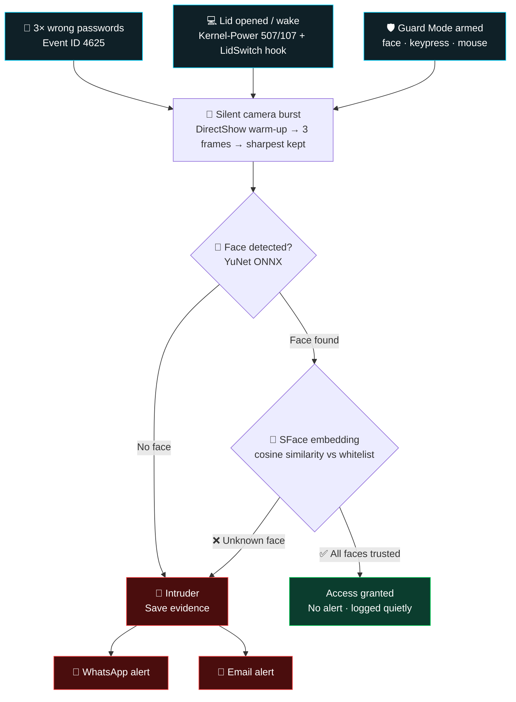

<div align="center">


### 🔐 A stealth physical-security daemon for Windows, with offline face whitelisting

[](https://www.python.org/)
[](https://www.microsoft.com/windows)
[](https://opencv.org/)
[](#-privacy--security-design)
[](LICENSE)

[](https://github.com/Deepak-Anuragi/IntruderLens/stargazers)
[](https://github.com/Deepak-Anuragi/IntruderLens/network/members)
[](https://github.com/Deepak-Anuragi/IntruderLens/commits/main)
[](https://github.com/Deepak-Anuragi/IntruderLens)

<br/>

> **Someone tries to get into your laptop without permission. IntruderLens quietly takes their photo and sends it to your phone.**
> **If it's you or your family, it stays silent.**

<br/>

[**🚀 Quick Start**](#-quick-start) &nbsp;•&nbsp;
[**✨ Features**](#-features) &nbsp;•&nbsp;
[**🧠 How It Works**](#-how-it-works) &nbsp;•&nbsp;
[**⌨️ Commands**](#️-command-cheat-sheet) &nbsp;•&nbsp;
[**⚙️ Config**](#️-configuration) &nbsp;•&nbsp;
[**🗺️ Roadmap**](#️-roadmap)

</div>

<br/>

<table align="center">
<tr>
<td align="center" width="25%"><h2>3</h2><sub>trigger sources<br/>password · lid · guard</sub></td>
<td align="center" width="25%"><h2>0</h2><sub>visible windows<br/>while running</sub></td>
<td align="center" width="25%"><h2>100%</h2><sub>on-device<br/>face recognition</sub></td>
<td align="center" width="25%"><h2>2</h2><sub>alert channels<br/>WhatsApp · Email</sub></td>
</tr>
</table>

---

## 🎯 The Problem

You leave your laptop for a few minutes and come back wondering:

- 🤔 *Did someone try to log in while I was away?*
- 🤔 *Who opened my laptop while the lid was closed?*
- 🤔 *Did anyone touch it while I stepped out without locking it?*

**IntruderLens answers all three automatically.** It runs in the background with no window and no tray icon. When someone tries to get in, it takes their photo and sends it to your phone. Faces you've enrolled are recognized offline, so you don't get alerts about yourself.

---

## ✨ Features

<table>
<tr>
<td width="50%" valign="top">

### 🔑 Wrong-Password Detection
Watches the Windows Security Event Log in real time. **3 wrong passwords within 2 minutes** silently fires the webcam.

</td>
<td width="50%" valign="top">

### 💻 Lid-Open / Wake Detection
Hooks Kernel-Power events and Win32 power notifications. The **moment your closed laptop is opened**, the camera captures whoever is in front of it.

</td>
</tr>
<tr>
<td width="50%" valign="top">

### 🧠 Intelligent Face Whitelisting
Offline **YuNet + SFace ONNX** models compare each face to your enrolled profiles (you, family, friends).
**Trusted face → no alert. Unknown face → instant alert.**

</td>
<td width="50%" valign="top">

### 📲 Instant Mobile Alerts
Sends the intruder's photo by **WhatsApp** (Twilio), **Email** (SMTP), or both. Alerts go out on a background thread, so monitoring never pauses.

</td>
</tr>
<tr>
<td width="50%" valign="top">

### 🤫 Fully Stealth
No windows, no taskbar icon, no flashes. Headless DirectShow burst capture keeps the **sharpest frame** using Laplacian variance scoring.

</td>
<td width="50%" valign="top">

### 🔒 Private by Design
All face recognition runs **on your machine**. No cloud APIs, no subscriptions, and no internet needed for recognition. Biometric data never leaves the device.

</td>
</tr>
<tr>
<td colspan="2" valign="top">

### 🛡️ Guard Mode: Arm It With a Shortcut
Stepping away without locking? Press **`Ctrl+Shift+G`** (or type a secret password) to arm Guard Mode. The moment **a face appears, a key is pressed, or the mouse/touchpad moves**, IntruderLens silently snaps a photo.
Your face → photo discarded. Anyone else → photo saved and alert sent.

</td>
</tr>
</table>

---

## 🧠 How It Works



---

## 🛠️ Tech Stack

<div align="center">


</div>

| Layer | Technology | Purpose |
| :--- | :--- | :--- |
| **Language** | Python 3.10+ | Core daemon |
| **Face detection** | OpenCV YuNet (ONNX) | Fast CNN face detector |
| **Face recognition** | OpenCV SFace (ONNX) | 128-D face embeddings + cosine similarity |
| **Camera** | OpenCV + DirectShow | Headless burst capture |
| **Event monitoring** | pywin32 `win32evtlog` | Security & System Event Log queries |
| **Power events** | Win32 `RegisterPowerSettingNotification` | Real-time lid / wake events |
| **Input hooks** | `keyboard` + `mouse` | Guard Mode hotkeys and triggers |
| **Alerts** | Twilio WhatsApp API + SMTP STARTTLS | Photo alerts on a background thread |
| **Autostart** | Windows Scheduled Task / NSSM | Silent background launch |

---

## 🚀 Quick Start

> **Requirements:** Windows 10/11 · Python 3.10+ · a webcam · Git

```powershell
# 1. Clone and install
git clone https://github.com/Deepak-Anuragi/IntruderLens.git
cd IntruderLens
pip install -r requirements.txt

# 2. Download the face models (~37 MB, from OpenCV Zoo)
python download_models.py

# 3. Teach it your face
python intruder_lens.py --enroll-face "Deepak"

# 4. Check everything is healthy
python intruder_lens.py --status

# 5. Install as a silent autostart task (Administrator PowerShell)
python intruder_lens.py --setup-task
```

That's it. IntruderLens now starts silently every time you log in. 🎉
The full walkthrough is below.

---

## 📖 Detailed Setup

<details>
<summary><b>Step 1: Clone & install dependencies</b></summary>
<br/>

```powershell
git clone https://github.com/Deepak-Anuragi/IntruderLens.git
cd IntruderLens
pip install -r requirements.txt
```

</details>

<details>
<summary><b>Step 2: Download the face recognition models</b></summary>
<br/>

The ONNX models are too large for the repo, so download them with:

```powershell
python download_models.py
```

They come from the official [OpenCV Zoo](https://github.com/opencv/opencv_zoo):

| Model | Size | Purpose |
| :--- | :--- | :--- |
| `face_detection_yunet_2023mar.onnx` | ~227 KB | Fast CNN face detector |
| `face_recognition_sface_2021dec.onnx` | ~37 MB | High-accuracy face recognizer |

</details>

<details>
<summary><b>Step 3: Enable Windows logon auditing</b> <i>(Administrator)</i></summary>
<br/>

This makes Windows log every failed login, which IntruderLens reads:

```powershell
auditpol /set /subcategory:"Logon" /success:enable /failure:enable
auditpol /set /subcategory:"Credential Validation" /success:enable /failure:enable
```

</details>

<details>
<summary><b>Step 4: Enroll your trusted faces</b></summary>
<br/>

This step is what lets IntruderLens tell you apart from strangers.

```powershell
# Look straight at the webcam: captures 5 face samples
python intruder_lens.py --enroll-face "Deepak"

# Optionally add family members
python intruder_lens.py --enroll-face "Mom"
python intruder_lens.py --enroll-face "Brother"

# Or enroll from an existing photo
python intruder_lens.py --enroll-face "Deepak" --image "C:\Users\Deepak\photo.jpg"

# See who is enrolled
python intruder_lens.py --list-faces
```

</details>

<details>
<summary><b>Step 5: Run system diagnostics</b></summary>
<br/>

```powershell
python intruder_lens.py --status
```

Healthy output looks like this:

```text
=================================================================
           IntruderLens System Diagnostics Report
=================================================================
[1] Administrative Privileges: YES (Can audit Security Log)
[2] Primary Webcam (Index 0): ONLINE & ACCESSIBLE
[3] Captures Directory: ...\captures (EXISTS & WRITABLE)
[4] Logs Directory:     ...\logs (EXISTS & WRITABLE)
[5] Face Recognition Engine: ONLINE (YuNet + SFace)
[6] Enrolled Trusted Profiles: 1
      - Deepak (5 face reference samples)
[7] Total Saved Snapshots: 0
-----------------------------------------------------------------
Wrong Password Threshold: 3 attempts in 120s
Lid-Open Capture Enabled: True (Cooldown: 20s)
Ignore Authorized Faces:  True
=================================================================
```

</details>

<details>
<summary><b>Step 6: Test without locking yourself out</b></summary>
<br/>

```powershell
python intruder_lens.py --test-camera        # webcam capture works?
python intruder_lens.py --test-lid           # simulate lid-open → ACCESS GRANTED or INTRUDER
python intruder_lens.py --test-failed-logon  # simulate 3 wrong passwords
python intruder_lens.py --test-guard         # arm Guard Mode now, then touch the keyboard/mouse
```

</details>

<details open>
<summary><b>Step 7: Go live</b></summary>
<br/>

**Option A: Foreground** (terminal stays open, good for testing)

```powershell
python intruder_lens.py --run
```

**Option B: Silent background autostart** ⭐ *recommended*

From an **Administrator PowerShell**:

```powershell
python intruder_lens.py --setup-task
```

This installs a Windows Scheduled Task (`IntruderLensDaemon`) that:

- ✅ launches silently every time you log in
- ✅ runs with highest privileges (so it can read the Security Event Log)
- ✅ runs in your desktop session (full webcam access)
- ✅ needs no further interaction

</details>

---

## ⌨️ Command Cheat Sheet

| Command | What it does |
| :--- | :--- |
| `--run` | Start the daemon in the foreground |
| `--setup-task` | Install the silent autostart Scheduled Task |
| `--status` | Show the diagnostics report |
| `--enroll-face NAME` | Enroll a trusted face from the webcam |
| `--enroll-face NAME --image PATH` | Enroll a trusted face from a photo |
| `--list-faces` | List enrolled trusted people |
| `--remove-face NAME` | Remove someone from the whitelist |
| `--test-camera` | Take one test photo |
| `--test-lid` | Simulate a lid-open trigger |
| `--test-failed-logon` | Simulate 3 wrong passwords |
| `--test-guard` | Arm Guard Mode immediately |
| `--test-alert` | Send a test alert with your newest capture |
| `--set-guard-shortcuts ACT DEACT` | Set custom Guard Mode hotkeys |
| `--set-guard-password PW [PW2]` | Use a typed password for Guard Mode |
| `--use-guard-shortcuts` | Switch Guard Mode back to hotkeys |

<sub>All commands run as `python intruder_lens.py <command>`.</sub>

---

## 🛡️ Using Guard Mode

Guard Mode starts automatically with the daemon (`--run` or the scheduled task). Your screen stays unlocked; you just arm it before walking away.

| Action | Default shortcut |
| :--- | :---: |
| Activate Guard Mode | <kbd>Ctrl</kbd> + <kbd>Shift</kbd> + <kbd>G</kbd> |
| Deactivate Guard Mode | <kbd>Ctrl</kbd> + <kbd>Shift</kbd> + <kbd>S</kbd> |

After activating, you get a **5-second arming delay** to step away. Once armed, any of these triggers a silent capture (each can be turned off in `config.py`):

| Trigger | |
| :--- | :--- |
| 👤 Face | A face appears in front of the webcam |
| ⌨️ Keyboard | Any key is pressed |
| 🖱️ Mouse / touchpad | Moved, clicked or scrolled |

Every capture goes through face recognition. **Your face → photo discarded, nothing saved.** Anyone else, or no visible face → saved as `captures/guard_*.jpg` and an alert is sent.

> [!TIP]
> Keyboard and mouse triggers wait a short grace period (`GUARD_MODE_INPUT_GRACE_SECONDS`, 2 s) before capturing. If you deactivate within that window the capture is cancelled, so your own deactivation keystrokes never cause an alert.

**Customize the controls.** CLI values are saved to the git-ignored `intruder_lens.ini` and override `config.py`:

```powershell
# Custom hotkeys: 2 or 3 keys each (same combo for both = toggle)
python intruder_lens.py --set-guard-shortcuts ctrl+alt+g ctrl+alt+u

# Use a typed password instead (typed anywhere, no Enter needed)
python intruder_lens.py --set-guard-password mysecret          # one password toggles on/off
python intruder_lens.py --set-guard-password armme disarmme    # separate passwords

# Switch back to hotkeys
python intruder_lens.py --use-guard-shortcuts
```

> [!NOTE]
> Guard Mode needs the interactive desktop session for its global keyboard/mouse hooks. Run it with `--run` or `--setup-task`, not with the Session-0 Windows Service wrapper.

---

## 📲 WhatsApp & Email Alerts

When an intruder photo is saved, you get a short alert like this:

```text
Intruder Lens Alert

Activity : Unknown face detected while Guard Mode was active
Time     : 20 Nov 2026, 09:41 PM
Device   : MY-LAPTOP

[Photo attached]
Stay safe.
```

<details>
<summary><b>What each trigger says</b></summary>
<br/>

| Trigger | Activity text |
| :--- | :--- |
| Wrong passwords | 3 consecutive wrong password attempts detected |
| Lid open / wake | Laptop lid opened or woken from sleep |
| Guard Mode: face | Unknown face detected while Guard Mode was active |
| Guard Mode: keyboard | Keyboard activity detected while Guard Mode was active |
| Guard Mode: mouse | Mouse/touchpad activity detected while Guard Mode was active |

</details>

**Choose your channels** in `config.py`:

| `NOTIFY_VIA_WHATSAPP` | `NOTIFY_VIA_EMAIL` | Result |
| :---: | :---: | :--- |
| `True` | `False` | 📱 WhatsApp only |
| `False` | `True` | 📧 Email only |
| `True` | `True` | 📱 + 📧 Both |
| `False` | `False` | 🤫 Silent: photo saved to disk only |

### 🔐 Where your credentials go

> [!IMPORTANT]
> `config.py` is committed to git, so keep **only placeholders** in it. Put real values in the git-ignored `intruder_lens.ini`, with lower-case key names.

```ini
[notifications]
notify_via_whatsapp = true
notify_via_email = true
twilio_account_sid = ACxxxxxxxxxxxxxxxxxxxxxxxxxxxxxxxx
twilio_auth_token = your-real-token
owner_whatsapp_number = whatsapp:+91XXXXXXXXXX
smtp_username = you@gmail.com
smtp_password = abcd efgh ijkl mnop
owner_email = you@gmail.com
```

You can also use environment variables prefixed with `INTRUDERLENS_`, such as `INTRUDERLENS_SMTP_PASSWORD`.
**Priority:** environment variables › `intruder_lens.ini` › `config.py`.

<details>
<summary><b>📱 WhatsApp setup (Twilio Sandbox)</b></summary>
<br/>

1. Create a free account at [twilio.com](https://www.twilio.com/). Copy your **Account SID** and **Auth Token** from the Console.
2. Open **Messaging → Try it out → Send a WhatsApp message**. From your phone, send the `join <code>` message it shows to the sandbox number (`+1 415 523 8886`).
3. Set `twilio_account_sid`, `twilio_auth_token` and `owner_whatsapp_number` (e.g. `whatsapp:+919876543210`), then set `notify_via_whatsapp = true`.

> [!WARNING]
> Twilio can only attach an image from a public URL. Before sending, IntruderLens uploads the photo to a temporary host that deletes it after 1 hour (`WHATSAPP_IMAGE_HOST = "litterbox"` by default, or `"imgbb"` with an `IMGBB_API_KEY`). Anyone with that link can open the photo until it expires. Set `WHATSAPP_IMAGE_HOST = "none"` for text-only WhatsApp alerts. If the upload fails, the text alert is still sent. Emails always attach the photo directly.

Sandbox sessions expire if you don't message the sandbox for 72 hours. Send `join <code>` again to re-activate.

</details>

<details>
<summary><b>📧 Email setup (SMTP)</b></summary>
<br/>

| Provider | `SMTP_HOST` | `SMTP_PORT` |
| :--- | :--- | :---: |
| Gmail | `smtp.gmail.com` | `587` |
| Outlook / Office 365 | `smtp.office365.com` | `587` |

For Gmail, turn on 2-Step Verification, then create an **App Password** at [myaccount.google.com/apppasswords](https://myaccount.google.com/apppasswords). Use it as `smtp_password`, **not** your normal password. The subject line is `IntruderLens Alert — <activity>` and the photo is attached.

</details>

**Test it:**

```powershell
python intruder_lens.py --test-alert   # sends a test alert with your newest capture
python intruder_lens.py --status       # shows which channels are enabled
```

---

## ⚙️ Configuration

All settings live in `config.py`.

<details>
<summary><b>🔑 Detection & face recognition</b></summary>
<br/>

| Parameter | Default | Description |
| :--- | :---: | :--- |
| `FAILED_ATTEMPT_THRESHOLD` | `3` | Wrong passwords before the camera fires |
| `ROLLING_WINDOW_SECONDS` | `120` | Sliding window (s) for counting failures |
| `COOLDOWN_SECONDS` | `30` | Minimum gap between wrong-password captures |
| `LID_OPEN_CAPTURE_ENABLED` | `True` | Enable lid-open / wake detection |
| `LID_COOLDOWN_SECONDS` | `20` | Anti-bounce cooldown between lid-open captures |
| `LID_HARDWARE_SETTLE_SECONDS` | `0.8` | Delay after wake so a USB camera can power up |
| `FACE_RECOGNITION_ENABLED` | `True` | Enable face whitelist comparison |
| `FACE_MATCH_THRESHOLD` | `0.35` | Cosine similarity cutoff (higher = stricter) |
| `IGNORE_AUTHORIZED_FACES` | `True` | Skip saving and alerting when every face in the photo is enrolled (a stranger next to the owner still triggers an alert). `False` saves and alerts for trusted faces too |
| `CAMERA_INDEX` | `0` | Webcam index (0 = primary / built-in) |

</details>

<details>
<summary><b>🛡️ Guard Mode</b></summary>
<br/>

| Parameter | Default | Description |
| :--- | :---: | :--- |
| `GUARD_MODE_ENABLED` | `True` | Start the Guard Mode listener with the daemon |
| `GUARD_MODE_ACTIVATE_SHORTCUT` | `"ctrl+shift+g"` | Hotkey to arm Guard Mode |
| `GUARD_MODE_DEACTIVATE_SHORTCUT` | `"ctrl+shift+s"` | Hotkey to disarm Guard Mode |
| `GUARD_MODE_USE_PASSWORD` | `False` | Use a typed password instead of hotkeys |
| `GUARD_MODE_PASSWORD` | `""` | Activation password (also deactivates unless a separate one is set) |
| `GUARD_MODE_DEACTIVATE_PASSWORD` | `""` | Optional separate deactivation password |
| `GUARD_MODE_TRIGGER_ON_FACE` / `_KEYPRESS` / `_MOUSE` | `True` | Which activity triggers a capture |
| `GUARD_MODE_ARM_DELAY_SECONDS` | `5.0` | Time to step away after activating |
| `GUARD_MODE_COOLDOWN_SECONDS` | `10.0` | Minimum gap between Guard Mode captures |

</details>

<details>
<summary><b>📲 Notifications</b></summary>
<br/>

| Parameter | Default | Description |
| :--- | :---: | :--- |
| `NOTIFY_VIA_WHATSAPP` | `False` | Send WhatsApp alerts via Twilio |
| `NOTIFY_VIA_EMAIL` | `False` | Send Email alerts via SMTP |
| `TWILIO_ACCOUNT_SID` / `TWILIO_AUTH_TOKEN` | placeholder | Twilio credentials (real values go in `intruder_lens.ini`) |
| `TWILIO_WHATSAPP_FROM` | `"whatsapp:+14155238886"` | Twilio sandbox sender |
| `OWNER_WHATSAPP_NUMBER` | placeholder | Your WhatsApp number, e.g. `whatsapp:+91…` |
| `WHATSAPP_IMAGE_HOST` | `"litterbox"` | Temporary photo host: `litterbox`, `imgbb`, or `none` |
| `SMTP_HOST` / `SMTP_PORT` | `smtp.gmail.com` / `587` | SMTP server (Outlook: `smtp.office365.com`) |
| `SMTP_USERNAME` / `SMTP_PASSWORD` | placeholder | SMTP login (Gmail: use an App Password) |
| `OWNER_EMAIL` | placeholder | Where alert emails go |

</details>

---

## 📂 Project Structure

```text
IntruderLens/
├── intruder_lens.py            # Core daemon: event listeners, camera pipeline, face decisions, CLI
├── face_engine.py              # Offline face detection (YuNet) + recognition (SFace)
├── guard_mode.py               # Guard Mode: hotkey/password listener, input & face triggers
├── notification_dispatcher.py  # WhatsApp (Twilio) + Email (SMTP) alert sender
├── config.py                   # All settings: thresholds, paths, alert placeholders
├── download_models.py          # One-command ONNX model downloader (OpenCV Zoo)
├── service_wrapper.py          # Optional native pywin32 Windows Service wrapper
├── requirements.txt
├── LICENSE
│
├── captures/        # 🔴 intruder photos       (gitignored)
├── logs/            # 🔴 operational logs      (gitignored)
├── models/          # 🔴 ONNX models           (gitignored, downloaded)
└── trusted_faces/   # 🔴 face embeddings       (gitignored, biometric data)
```

---

## 🔒 Privacy & Security Design

| | |
| :---: | :--- |
| 🧠 | **Fully local AI.** YuNet and SFace run on-device through OpenCV's ONNX runtime. No biometric data leaves your machine. |
| 📴 | **No cloud for recognition.** Detection, recognition and matching all work offline. |
| 🙈 | **Sensitive folders are gitignored.** `captures/`, `trusted_faces/` and `logs/` are never committed. |
| 🔑 | **Placeholder credentials only.** Real tokens live in the git-ignored `intruder_lens.ini` or environment variables. |
| 🔐 | **Encrypted alerts.** Twilio and photo uploads use HTTPS; email uses STARTTLS. WhatsApp photos sit on a temporary public link for up to 1 hour; set `WHATSAPP_IMAGE_HOST = "none"` to avoid that. |

---

## 🗺️ Roadmap

**Shipped ✅**

- [x] Wrong-password detection via Security Event Log (Event 4625/4624)
- [x] Lid-open & system-wake detection (Kernel-Power + Win32 hook)
- [x] Offline face detection (YuNet) and recognition (SFace)
- [x] Multi-user enrollment (owner + unlimited family/friends)
- [x] Alert suppression for authorized faces
- [x] Silent headless DirectShow burst capture
- [x] WhatsApp (Twilio) and SMTP email photo alerts, each toggleable
- [x] Silent autostart via Windows Scheduled Task
- [x] Built-in simulation & diagnostic CLI
- [x] Guard Mode: hotkey/password-armed watch mode (face, keyboard, mouse triggers)

**Up next 🚧**

- [ ] Discord webhook alerts
- [ ] Mobile push notifications (Pushover / Pushbullet)
- [ ] Offline alert queue that sends when Wi-Fi reconnects
- [ ] Low-light / dark-room fallback policy
- [ ] Local web dashboard to browse capture history

---

## 🤝 Contributing

Contributions are welcome!

1. **Fork** the repository
2. **Create** a feature branch: `git checkout -b feature/discord-alerts`
3. **Commit** your changes: `git commit -m "Add Discord webhook alert dispatcher"`
4. **Push** the branch: `git push origin feature/discord-alerts`
5. **Open a Pull Request** describing what you built and why

For major changes, please open an issue first to discuss the approach.

---

## 📄 License

Released under the **MIT License**. See [LICENSE](LICENSE) for details.

## ⚠️ Legal Disclaimer

> [!CAUTION]
> IntruderLens is meant strictly for personal security on **your own device**. Recording or monitoring people without their knowledge or consent may be **illegal where you live**. The author accepts no liability for misuse. Always follow your local privacy and surveillance laws.

---

<div align="center">

**Built with ❤️ by [Deepak Anuragi](https://github.com/Deepak-Anuragi)**

*If IntruderLens helped you, a* ⭐ *on the repo means a lot!*


</div>
